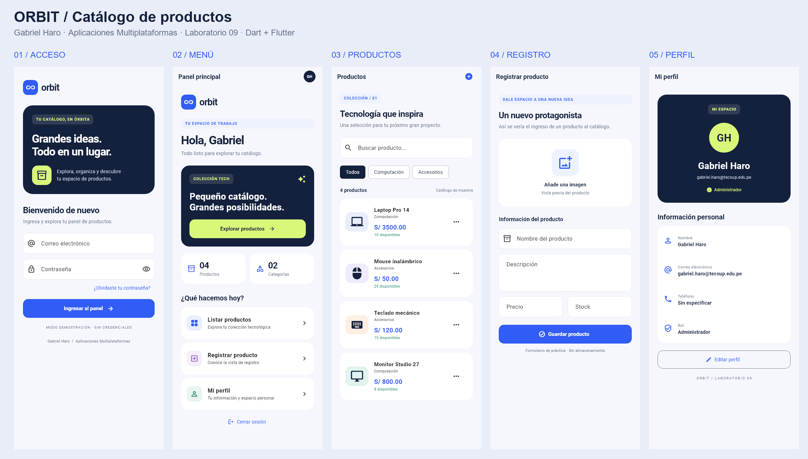
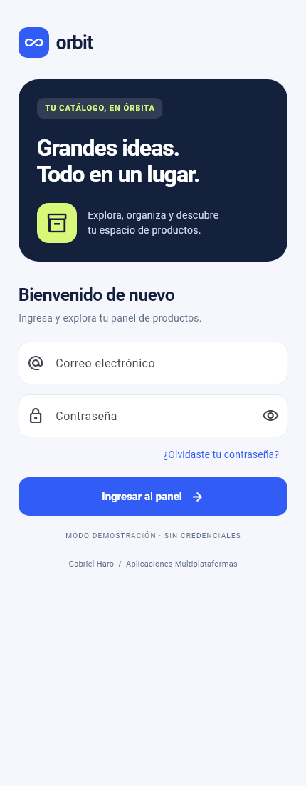
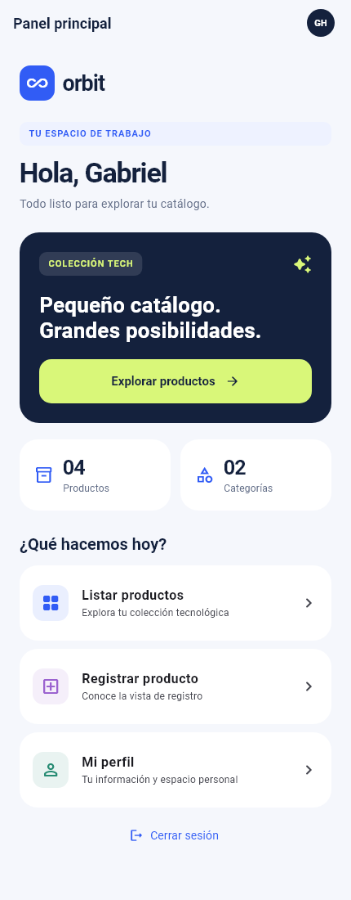
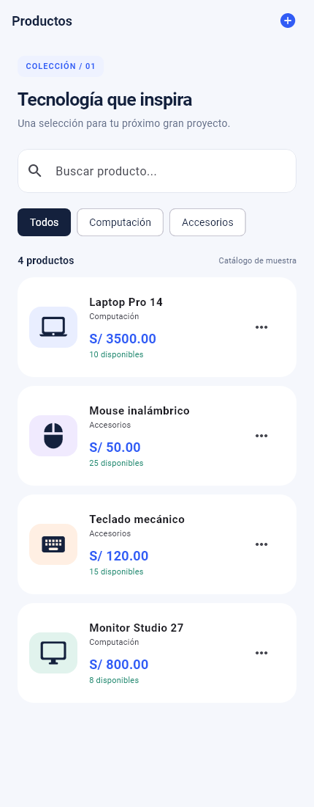
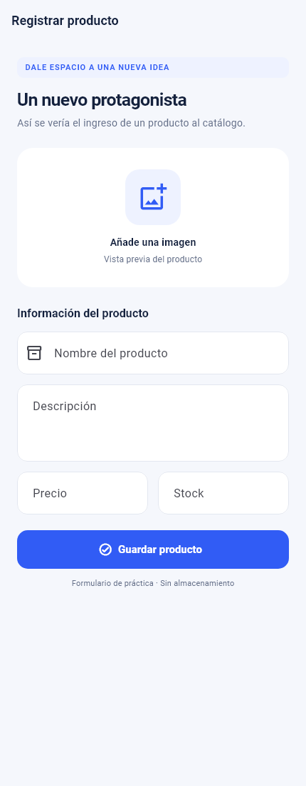
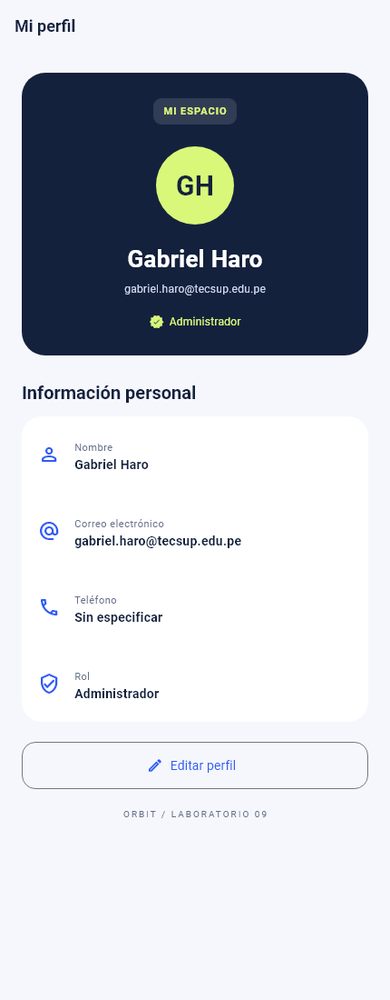

# Orbit — Catálogo de productos

**Gabriel Haro · Aplicaciones Multiplataformas · Laboratorio 07-08 · Sección B**

Prototipo de interfaz desarrollado en **Dart con Flutter**. Presenta cinco pantallas conectadas por rutas, un catálogo de datos locales y una propuesta de diseño propia basada en la actividad del curso.

**Repositorio:** [gabrielharo-dotcom/semana09-orbit-flutter](https://github.com/gabrielharo-dotcom/semana09-orbit-flutter)

## Vista general



## Lo que se desarrolló

- **Acceso:** campos de correo y contraseña, opción de mostrar contraseña e ingreso simulado sin credenciales.
- **Menú:** saludo personal, panel destacado, tarjetas de resumen y accesos al catálogo, registro y perfil.
- **Productos:** cuatro productos de muestra, búsqueda por nombre, categorías y ficha inferior de detalles.
- **Registro:** formulario visual con campos de nombre, descripción, precio y stock. Guardar muestra un aviso y no crea registros.
- **Perfil:** información de Gabriel Haro y botón de edición con aviso demostrativo.
- **Navegación:** avance, retorno, acceso directo al registro desde Productos y cierre de sesión que limpia las rutas anteriores.

## Diseño del front

Orbit utiliza azul eléctrico, azul oscuro y lima como colores de identidad. Incluye una tipografía local, jerarquía de títulos, Cards redondeadas, iconos Material, botones consistentes, filtros y un estado vacío de búsqueda. Las vistas permiten desplazamiento en móviles y limitan su ancho en escritorio para conservar legibilidad.

Toda la interfaz y su comportamiento están en archivos `.dart`. Los archivos de Android y el contenedor web son los generados por Flutter para ejecutar la aplicación en esas plataformas.

## Temas del laboratorio

| Requisito | Implementación |
| --- | --- |
| ListViews | Menú, formularios, perfil y catálogo con `ListView.separated`. |
| ListTiles | Opciones del menú, productos e información del perfil. |
| Listas y mapas | Productos en `List<Map<String, Object>>`, perfil en un mapa y opciones del menú generadas desde datos. |
| Rutas | Cinco rutas definidas en `MaterialApp`, usando `Navigator`. |
| Tema global | `ThemeData` con colores, tipografía, estilos de campos, botones y Cards. |
| Cards | Tarjetas de resumen, opciones, productos, imagen e información personal. |

## Ejecutar

Requiere Flutter estable con Dart 3.10 o superior y un dispositivo Android o Chrome/Edge disponible. Verificar el entorno con `flutter doctor`.

```powershell
git clone https://github.com/gabrielharo-dotcom/semana09-orbit-flutter.git
cd semana09-orbit-flutter
flutter pub get
flutter run -d chrome
```

Para Android: conectar el dispositivo o iniciar el emulador, consultar `flutter devices` y ejecutar `flutter run -d ID_DEL_DISPOSITIVO`.

**Acceso de práctica:** presionar “Ingresar al panel”; no se necesitan correo ni contraseña.

## Organización

```text
lib/
  main.dart                 Punto de entrada y autor
  app.dart                  MaterialApp, tema y mapa de rutas
  data/demo_data.dart       Listas y mapas de ejemplo
  theme/app_theme.dart      Tema global
  widgets/shared.dart       Componentes reutilizables y avisos
  screens/                  Las cinco pantallas
test/laboratorio_test.dart  Navegación, filtros, capturas y tamaños
docs/EXPLICACION.md         Desarrollo y explicación del código adicional
docs/capturas/             Evidencias visuales
```

## Comentarios del código complementario

El código incluye comentarios en los puntos principales. La explicación ampliada está en [EXPLICACION.md](docs/EXPLICACION.md), con `StatefulWidget`, `setState`, `where`, `map`, conversiones de tipos, pila de navegación, componentes compartidos, `SafeArea`, `ConstrainedBox`, `SnackBar`, `showModalBottomSheet` y fuentes locales. Como no se proporcionó el listado exacto de lo visto en clases, se documentaron estos recursos como material complementario.

## Capturas individuales

| Acceso | Menú | Productos | Registro | Perfil |
| --- | --- | --- | --- | --- |
|  |  |  |  |  |

Las capturas se renderizan desde widgets reales de Flutter mediante pruebas visuales; no son maquetas dibujadas.

## Comprobaciones

```powershell
flutter analyze
flutter test
flutter build web --release
```

Las pruebas comprueban navegación, retorno, cierre de sesión, aviso de registro, filtros por nombre y categoría, estado sin resultados y ausencia de desbordamientos a 320 × 640 y 1440 × 900. También comparan las cinco capturas de referencia. Para regenerarlas intencionalmente: `flutter test --update-goldens`. Pueden existir diferencias de renderizado entre sistemas operativos.

## Alcance del prototipo

No incluye autenticación real, API, backend, base de datos, creación de registros ni persistencia. La selección de imagen, recuperación de contraseña, guardado y edición muestran avisos. Los campos de texto y filtros manejan únicamente estado visual temporal. El teléfono no se inventó: figura como “Sin especificar”.

## Recursos

- [Informe Word con capturas y enlace del repositorio](docs/Laboratorio09-Gabriel-Haro.docx).
- [Búsqueda en funcionamiento](docs/capturas/06-busqueda.png) y [aviso al guardar](docs/capturas/07-aviso-registro.png).
- [Explicación y guion para la exposición](docs/EXPLICACION.md).
- [Rutas en Flutter](https://docs.flutter.dev/cookbook/navigation/named-routes).
- [Tema global en Flutter](https://docs.flutter.dev/cookbook/design/themes).
- Roboto se distribuye con su [licencia](assets/fonts/roboto_license.txt).

**Autor del laboratorio: Gabriel Haro.**
